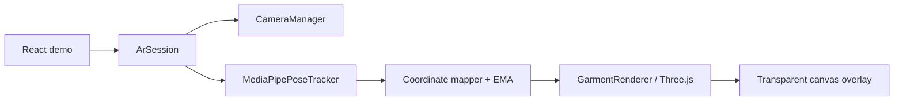

# Kiến trúc

`packages/ar-core` không import React và không gọi backend. `ArSession` sở hữu lifecycle: start → camera + model → frame loop; stop/dispose → hủy animation frame, đóng landmarker, stop toàn bộ track và dispose WebGL.

Public API: `ArSession`, `GarmentRenderer`, `CameraManager`, `MediaPipePoseTracker`, `PoseSmoother`, `GARMENTS`, types. UI chỉ truyền video/canvas refs và nghe event state/tracking/error.
